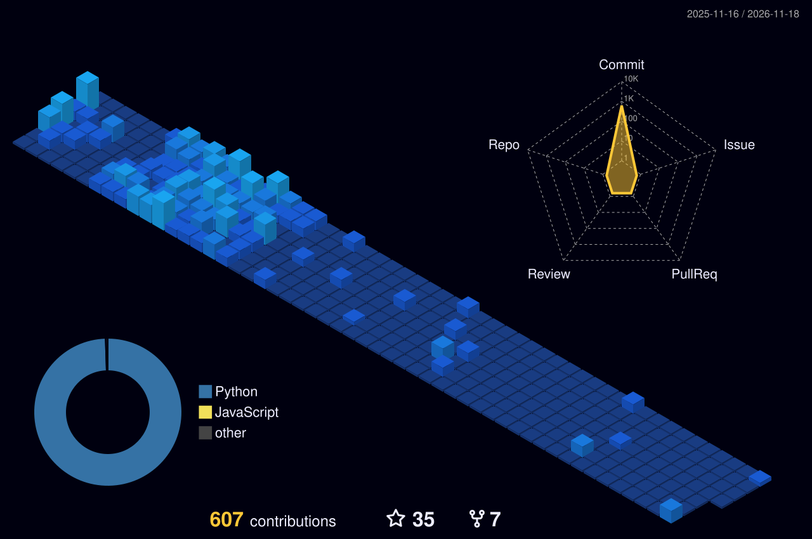

  <!-- Blue Tech Header Banner -->
  

  <!-- Animated Typing Introduction -->
  

<h1 align="left">Hi there, I'm Shreyansh Dubey </h1> 
<h3 align="left">

  
 
</h3> 

<table>
  <tr>
    <td>

  I’m exploring Langchain, n8n, MCP, and advanced Machine Learning. I love staying curious and trying out new ideas.

  When I’m not coding, you’ll probably find me sipping coffee , or watching one piece. If any of that resonates with you, I’d love to connect whether it’s to collaborate, chat about ideas, or just geek out over new frameworks.

  📁 <strong>Portfolio:</strong> <a href="https://shreyanshdubey.vercel.app/" target="_blank">Visit My Website</a> 
  📫 <strong>Email:</strong> <a href="mailto:shreyansh2128@gmail.com">shreyansh2128@gmail.com</a>

  </td>
    <td>
      
    </td>
  </tr>
</table>

🌍 **Connect With Me:**  

  
  
  
  
   
  
  
  
  
  
  
  

⚙️ **Tech Stack:**  

  

<!-- GitHub Stats + Streak -->

  
  

---

🏆 **3D Contribution Heatmap:**  

  

 

  <!-- Blue Tech Footer Banner -->
  

